<div align="center">

<picture>
  <source media="(prefers-color-scheme: dark)" srcset="../assets/logo-dark.svg">
  
</picture>

### 给模型逐层读的视频拆解开放格式

**每个技能有一个 `SKILL.md`，每条视频也有一个 `VIDEO.md`。**

[](https://pypi.org/project/videomd/)
[](SPEC_zh.md)
[](#许可)

[**网站**](https://videomd.github.io/videomd/zh/) · [规范](SPEC_zh.md) · [接入指南](integrate_zh.md) · [生成指南](authoring_zh.md) · [English](../README.md)

</div>

---

一个 VIDEO.md 拆片包给 AI agent 和程序描述一条视频：逐镜讲了什么、画面里有什么；生成方知道的话，还有每一镜是怎么做的、怎么复刻。它从一张小卡片开始，逐层展开，直到单个镜头。每个文件都写明自己有多少 token，**看到的**和**推断的**分开写。

可以这样理解：卡片是这条视频的身份证，一眼看清它是什么、怎么做的、有多确定；整个包是它的档案，要查哪一层就翻到哪一层，不用整本读完。

<picture>
  <source media="(prefers-color-scheme: dark)" srcset="../assets/levels-dark-zh.svg">
  
</picture>

## 一个包长什么样

```
coffee-ad/
├── VIDEO.md            卡片 + 概览和地图          先读
├── video/
│   ├── timeline.md     一行一个镜头               问到具体镜头时读
│   ├── sound.md  …     一个主题一个文件           问到这个主题时读
│   └── shots/01.md     某一镜的全部细节           核实某一镜时读
└── frames/ …           原始数据和媒体文件         给程序和看图模型
```

<table>
<tr>
<td width="50%" valign="top">

**卡片**：agent 只看它就能决定要不要打开这个包

```yaml
---
videomd: 1
name: coffee-ad
description: >-
  一条 10 秒的咖啡广告：一只手往
  玻璃杯里倒咖啡，然后一张卡片
  显示价格。实拍（70%）+ 代码
  渲染的价格卡（30%）。
source:
  file: coffee-ad.mp4
  sha256: 9f86d0…
  duration: 10.0
shots: 2
lang: zh
---
```

</td>
<td width="50%" valign="top">

**时间线**：一行一个镜头，键名带 `~` 的是推断

```
#01 0.0-7.0
  | seen 一只手往玻璃杯里倒咖啡
  | camera 手持
  | made~ 实拍 92%

#02 7.0-10.0
  | seen 米色卡片上写着价格
  | overlay 标题
  | made~ 代码渲染 61%
    · 次选 录屏 30%
  | flag 低置信
```

</td>
</tr>
</table>

## 为什么用 VIDEO.md

一条视频的完整拆解动辄几十万 token。模型每回答一个问题都读一遍，又慢又贵，还容易把猜测当事实复述。

| | |
|---|---|
| 🗂️ **上下文里放得下很多视频** | 每张卡片几百 token，都放在上下文里，用到时才打开对应的包，和技能一样。 |
| 🪜 **问题需要多少就读多少** | 多数问题读概览就能回答，约 2k token；加上时间线约 4k，单个镜头的问题也能答。 |
| 🏷️ **读之前就知道代价** | 地图列出每个文件和它的 token 数。 |
| 🔍 **看到的和推断的分开** | 语法里分（`made~`），数据里也分（`inferred`，附概率和由谁判定）。 |
| 🧩 **程序有稳定的接口** | 前置信息有 JSON Schema 校验，时间线有固定语法，id 固定。不认识的字段、键、文件一律忽略，格式可以持续扩展。 |
| 🌱 **门槛低** | 六个字段就是一张合格的卡片。判断视频怎么做的是可选模块，不是必需的。 |

## 快速开始

```bash
pip install videomd
videomd check path/to/package      # 逐条列出不合格的地方；有问题时退出码为 1
videomd read path/to/package       # 以 JSON 输出卡片、地图、时间线和每镜数据
```

```python
import videomd

errors = videomd.check("path/to/package")
pkg = videomd.read("path/to/package")   # {"card": {...}, "map": [...], "timeline": [...], "shots": {1: {...}}}
```

- **做 agent 或应用？** 读 [接入指南](integrate_zh.md)：怎么发现拆片包、往上下文里放什么、什么时候加载更多、怎么如实回答。
- **做拆解工具？** 读 [生成指南](authoring_zh.md)：从最小的合格包到完整的包。
- **想看一个真实的包？** 打开 [examples/salted-egg/VIDEO.md](https://github.com/videomd/videomd/blob/main/examples/salted-egg/VIDEO.md)，21 个镜头。

## 文档

| | |
|---|---|
| [规范](SPEC_zh.md) | 规范正文 |
| [接入指南](integrate_zh.md) | 在 agent 或应用里用拆片包 |
| [生成指南](authoring_zh.md) | 写拆片包 |
| [设计思路](design_zh.md) | 为什么这样设计：借鉴了 Agent Skills 和小型 DSL 的哪些做法 |
| [TAXONOMY.md](../TAXONOMY.md) | 标准 id：制作方式、运镜、叠加层、判断来源、标记 |
| [schema/](../schema/videomd-1.schema.json) | 所有前置信息的 JSON Schema |
| [examples/](https://github.com/videomd/videomd/tree/main/examples/) | 完整的拆片包 |
| [conformance/](https://github.com/videomd/videomd/tree/main/conformance/) | 合格的包，以及各违反一条规则的包 |
| [IMPLEMENTATIONS.md](../IMPLEMENTATIONS.md) | 生成和读取 VIDEO.md 的工具 |
| [CHANGELOG.md](../CHANGELOG.md) | 各版本的改动 |

## 实现

| 工具 | 作用 |
|---|---|
| [rea-video](https://github.com/JuneYaooo/rea-video) | 生成拆片包：逐镜拆解、每镜的制作方式、声音、包装、复刻方案 |
| [videomd](https://github.com/videomd/videomd/tree/main/src/videomd/) | 本仓库里的参考读取库和校验器 |

做了生成或读取 VIDEO.md 的工具？欢迎加到 [IMPLEMENTATIONS.md](../IMPLEMENTATIONS.md)。

## 参与

欢迎开 issue 提议新字段、新键和新的取值 id，见 [CONTRIBUTING.md](../CONTRIBUTING.md)。

## 许可

规范和文档使用 [CC BY 4.0](https://creativecommons.org/licenses/by/4.0/)，代码、schema 和一致性测试文件使用 [Apache-2.0](https://github.com/videomd/videomd/blob/main/LICENSE)。
